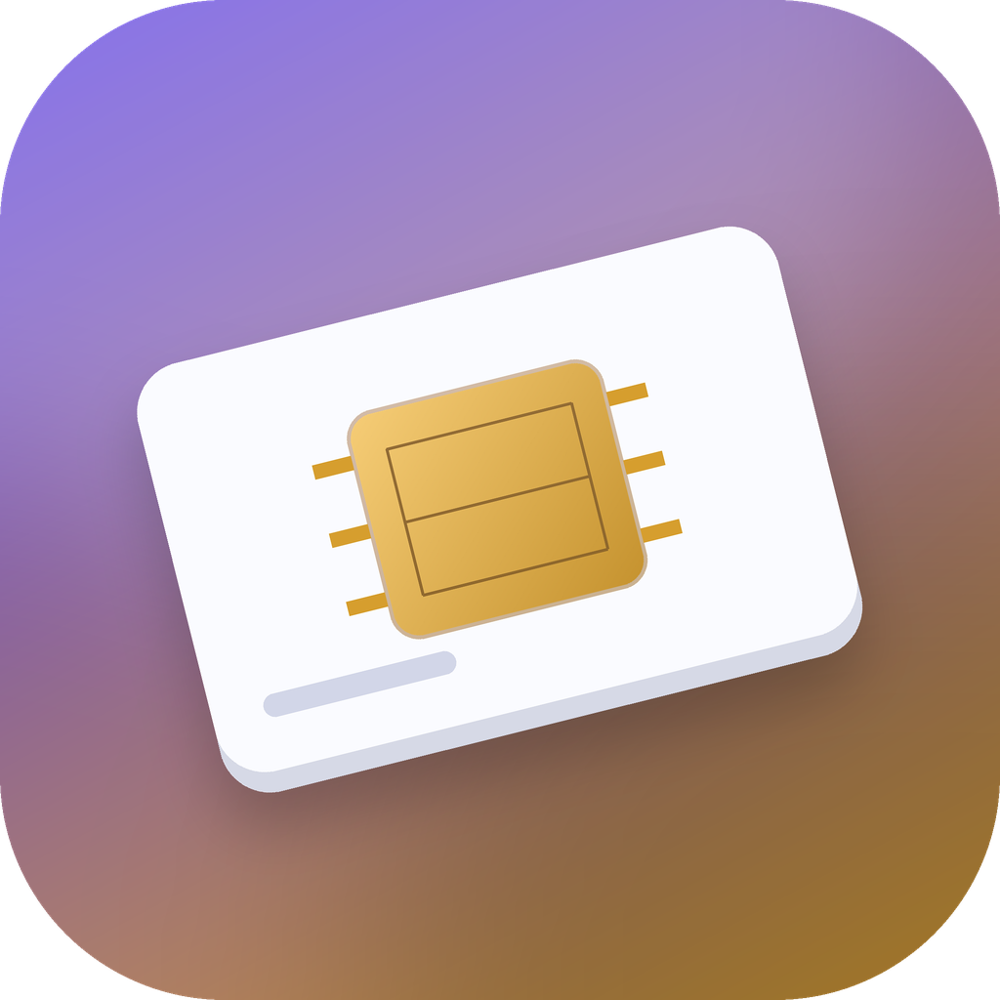
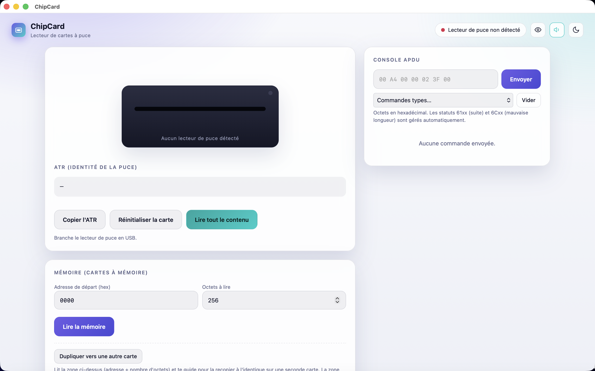

<p align="center">
  
</p>
<h1 align="center">ChipCard</h1>
<p align="center">Read and write smart cards on a Mac, tested with a HID OMNIKEY 3121 reader.</p>
<p align="center">
  <a href="README.md">Français</a> ·
  
  
</p>

<p align="center"></p>

> **Intended use.** ChipCard is a personal research and learning tool for reading/writing **your own smart cards** (badges, test cards, hobby projects) whose content you have the right to change. It speaks the standard PC/SC protocol (ATR, APDU) without bypassing any protection or cloning a secured card: it only reads and writes what the reader itself is willing to communicate. Only use it on hardware you own or are authorized to handle.

## What it does

ChipCard drives a **PC/SC** smart-card reader from a real macOS application, with a simple interface:

- ATR reading and card exploration (AID, EF/DF files);
- free APDU console, with a few built-in sample commands;
- reading and **writing** synchronous memory cards (e.g. SLE4428), with PSC code support;
- a guard on the protected zone (addresses `0000`–`001F`), requiring explicit confirmation before touching it;
- plain-text ↔ hexadecimal conversion, copying the plain-text content (excluding the protected zone);
- guided duplication from one card to another, and a quick "blank / already used" indicator.

This project is the companion of [MagCard](https://github.com/Wudstyz/MagCard), which does the same for magnetic-stripe cards (MSR605X reader). The two are deliberately separate applications, each with its own name and icon, to keep things simple.

## Installation

1. Download the latest release from the [Releases](../../releases) tab (`.dmg` file).
2. Open the `.dmg`, drag **ChipCard** into *Applications*.
3. First launch: the app is not notarized by Apple (no paid developer account for this small free project). macOS may refuse to open it on the first double-click — **right-click → Open**, then confirm. If that's not enough, run in Terminal:
   ```bash
   xattr -dr com.apple.quarantine "/Applications/ChipCard.app"
   ```

Nothing else to install: no Python, no Homebrew, no Node — everything is bundled in the app.

## Getting started

1. Plug in the smart-card reader over USB, insert a card.
2. Launch ChipCard: the ATR shows up as soon as the card is detected.
3. **Read everything**, or use the **Memory** section to read/write an address range.
4. To write: enter the PSC code if the card has one (`FF FF` by default on fresh SLE4428 cards), then **Write**. The `0000`–`001F` zone is protected by default — it holds data some readers use to recognize the card, and overwriting it can make the card unreadable.

## Compatibility and known limitations

- **Tested and reliable for both reading and writing**: **HID OMNIKEY 3121** reader, **SLE4428** memory cards.
- **ACS ACR39U reader**: reads memory cards correctly, but its VERIFY command implementation (PSC code presentation) is not reliable with this driver on macOS — writes may fail. Prefer the OMNIKEY if you have a choice.
- Tested on **Apple Silicon Mac (arm64)** only, not on Intel Macs nor on a second Mac.
- **Card duplication** and the **blank/used indicator** are implemented but had not yet been validated on real hardware at the time of publishing — test them carefully the first time, preferably on a card with no value on it.
- No hardware-free simulation mode yet: a PC/SC reader must be plugged in to try the app.
- The app is not notarized (see above).

## Building from source

```bash
git clone https://github.com/Wudstyz/ChipCard.git
cd ChipCard
./build_app.sh     # builds ChipCard.app (downloads its dependencies into .venv/)
./make_dmg.sh      # builds ChipCard.dmg from ChipCard.app
```

## Code layout

- `app.py` / `app_common.py` — native window (pywebview) around the local server.
- `chip.py` — PC/SC communication (APDU, ATR decoding, memory read/write).
- `msr.py` — small local HTTP server bridging `chip.py` to the UI.
- `web/index.html` — the UI (a single page, no external dependency).
- `build_assets/` — icon generation.

## Contributing

Suggestions and pull requests are welcome, especially for compatibility with other readers or other smart-card families.

## License

[MIT](LICENSE) — see also [THIRD_PARTY_NOTICES.md](THIRD_PARTY_NOTICES.md).
