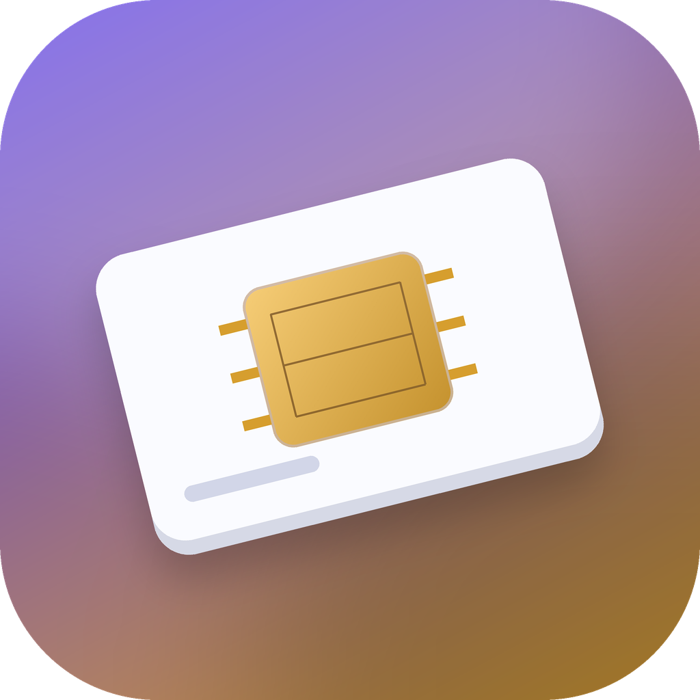
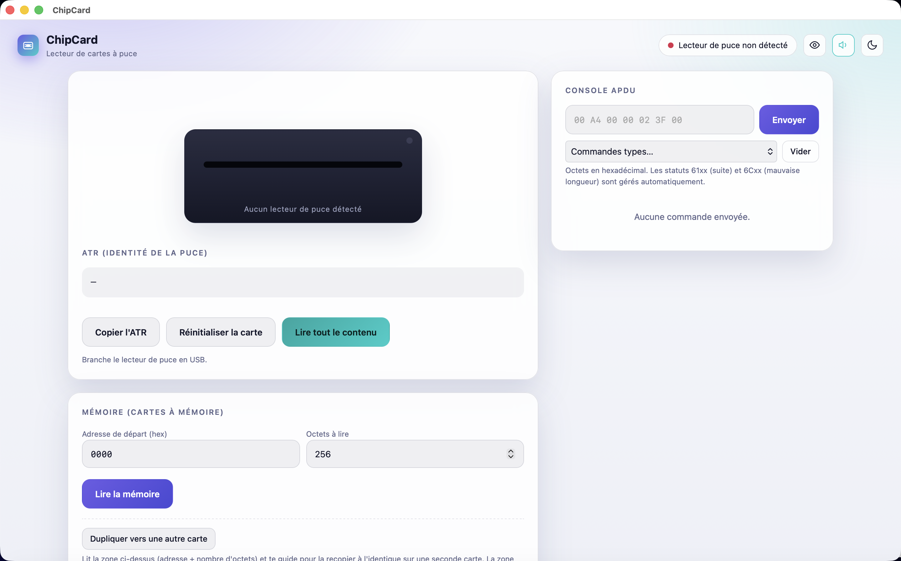

<p align="center">
  
</p>
<h1 align="center">ChipCard</h1>
<p align="center">Lire et écrire des cartes à puce sur Mac, testé avec un lecteur HID OMNIKEY 3121.</p>
<p align="center">
  <a href="README.en.md">English</a> ·
  
  
</p>

<p align="center"></p>

> **Usage prévu.** ChipCard est un outil personnel de recherche et d'apprentissage pour lire/écrire **tes propres cartes à puce** (badges, cartes de test, projets perso) dont tu as le droit de modifier le contenu. Il parle le protocole standard PC/SC (ATR, APDU) sans contourner de protection ni cloner une carte sécurisée : il lit et écrit ce que le lecteur veut bien communiquer, rien de plus. Utilise-le uniquement sur du matériel qui t'appartient ou que tu es autorisé à manipuler.

## Ce que ça fait

ChipCard pilote un lecteur de cartes à puce **PC/SC** depuis une vraie application macOS, avec une interface simple en français :

- lecture de l'ATR et exploration de la carte (AID, fichiers EF/DF) ;
- console APDU libre, avec quelques commandes types ;
- lecture et **écriture** de cartes à mémoire synchrone (ex. SLE4428), avec code PSC ;
- garde-fou sur la zone protégée (adresses `0000`–`001F`), confirmation explicite requise pour y toucher ;
- conversion texte clair ↔ hexadécimal, copie du contenu en clair (hors zone protégée) ;
- duplication guidée d'une carte vers une autre, et indicateur rapide « carte vierge / déjà utilisée ».

Ce projet est le compagnon de [MagCard](https://github.com/Wudstyz/MagCard), qui fait la même chose pour les cartes à piste magnétique (lecteur MSR605X). Les deux sont volontairement deux applications séparées, chacune avec son propre nom et sa propre icône, pour rester simples.

## Installation

1. Télécharge la dernière version dans l'onglet [Releases](../../releases) (fichier `.dmg`).
2. Ouvre le `.dmg`, glisse **ChipCard** dans *Applications*.
3. Premier lancement : l'application n'est pas notariée par Apple (pas de compte développeur payant pour ce petit projet gratuit). Au premier double-clic, macOS peut refuser de l'ouvrir — fais **clic droit → Ouvrir**, puis confirme. Si ça ne suffit pas, lance dans le Terminal :
   ```bash
   xattr -dr com.apple.quarantine "/Applications/ChipCard.app"
   ```

Rien d'autre à installer : ni Python, ni Homebrew, ni Node — tout est embarqué dans l'application.

## Premiers pas

1. Branche le lecteur de cartes à puce en USB, insère une carte.
2. Lance ChipCard : l'ATR s'affiche dès que la carte est détectée.
3. **Lire tout le contenu**, ou utilise la section **Mémoire** pour lire/écrire une plage d'adresses.
4. Pour écrire : renseigne le code PSC si la carte en a un (`FF FF` par défaut sur les cartes neuves SLE4428), puis **Écrire**. La zone `0000`–`001F` est protégée par défaut — elle contient des données lues par certains lecteurs pour reconnaître la carte, l'écraser peut la rendre illisible.

## Compatibilité et limites connues

- **Testé et fiable en lecture ET en écriture** : lecteur **HID OMNIKEY 3121**, cartes à mémoire **SLE4428**.
- **Lecteur ACS ACR39U** : lit correctement les cartes à mémoire, mais son implémentation de la commande VERIFY (présentation du code PSC) ne fonctionne pas de façon fiable avec ce pilote sur macOS — l'écriture peut échouer. Préfère l'OMNIKEY si tu as le choix.
- Testé sur **Mac Apple Silicon (arm64)** uniquement, pas sur Mac Intel ni sur un deuxième Mac.
- La **duplication de carte** et l'**indicateur vierge/utilisée** sont implémentés mais n'ont pas encore été validés sur du matériel réel au moment de la publication — teste-les prudemment la première fois, de préférence sur une carte sans valeur.
- Pas de mode de simulation sans matériel pour l'instant : il faut un lecteur PC/SC branché pour essayer l'application.
- L'application n'est pas notariée (voir ci-dessus).

## Construire depuis les sources

```bash
git clone https://github.com/Wudstyz/ChipCard.git
cd ChipCard
./build_app.sh     # construit ChipCard.app (télécharge ses dépendances dans .venv/)
./make_dmg.sh      # construit ChipCard.dmg à partir de ChipCard.app
```

## Organisation du code

- `app.py` / `app_common.py` — fenêtre native (pywebview) autour du serveur local.
- `chip.py` — communication PC/SC (APDU, décodage ATR, lecture/écriture mémoire).
- `msr.py` — petit serveur HTTP local qui relie `chip.py` à l'interface.
- `web/index.html` — interface (une seule page, sans dépendance externe).
- `build_assets/` — génération de l'icône.

## Contribuer

Les suggestions et pull requests sont bienvenues, en particulier pour la compatibilité avec d'autres lecteurs ou d'autres familles de cartes à puce.

## Licence

[MIT](LICENSE) — voir aussi [THIRD_PARTY_NOTICES.md](THIRD_PARTY_NOTICES.md).
